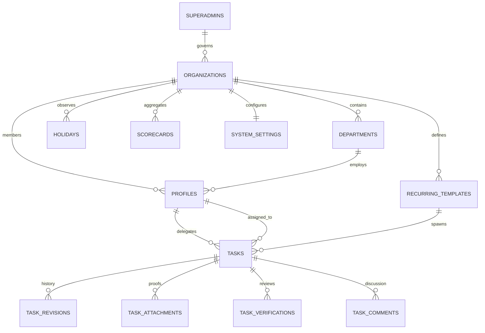

# StackDrove CTMS — Cloud-Native Web Architecture Specification
**Enterprise Centralized Task Management System (CTMS)**  
*Next.js (React 19) • Supabase (PostgreSQL & RLS) • Cloudinary • Microsoft 365 Email • CEOITBOX / Meta WhatsApp*

---

## 1. System Vision & Multi-Tenant SaaS Objective

The objective of this project is to re-engineer the Google Sheets-based **CTMS** into a modern, cloud-hosted, ultra-responsive multi-tenant SaaS web platform. The platform eliminates spreadsheet row-limits, concurrency locks, and Apps Script quota constraints while introducing a comprehensive **Hierarchical Access & Licensing Control System** that allows StackDrove to distribute and govern CTMS across distinct corporate domains and client organizations.

### Multi-Tier Administrative & Operational Governance
The system operates on a structured 3-tier administrative hierarchy alongside 3 specialized operational roles:

1. **Superadmin (Platform Owner / StackDrove Master)**:
   - Masters platform-wide tenancy and subscription lifecycle.
   - Authorizes and binds the system to specific corporate domains (e.g. `@acmecorp.com`).
   - Provisions organization tenants, assigns subscription tiers (Starter, Pro, Enterprise), and sets seat limits.
   - **Emergency Kill Switch & Subscription Control**: Instantly suspends or activates access for any organization from the central platform dashboard upon subscription expiration or non-payment.
   - Onboards the initial **Company Admin** for each client organization.

2. **Company Admin (Organization Head / Tenant Owner)**:
   - Primary organizational stakeholder who receives first-time access to the organization's tenant workspace.
   - Manages organization profile, branding, and billing/subscription visibility.
   - Holds master authority over organization integration settings:
     - **Cloudinary Storage**: API keys, cloud name, secrets, and upload presets.
     - **Microsoft 365 Email**: Enterprise SMTP credentials, app passwords, and sender identity.
     - **WhatsApp Gateway**: Official Meta Cloud API (token, phone ID, templates) and CEOITBOX Gateway credentials.
   - Manages user access, authorizes company users within the whitelisted corporate domain, and appoints operational **Admins**.

3. **Admin (Delegated Operational Administrator)**:
   - Operates on behalf of the Company Admin to run day-to-day governance.
   - Manages departments, user roles (`BOSS`, `DELEGATOR`, `DELEGATEE`), and employee onboarding/offboarding.
   - Manages task datasets: Add, edit, archive, and delete task records.
   - Configures SLA parameters, holiday calendars, and column visibility/edit permission matrices.

4. **Operational Roles**:
   - **Boss (Executive / C-Suite)**: Global cross-department visibility, company-wide bottleneck monitoring, executive reminders, and high-level KPI analytics.
   - **Delegator (Manager / Assigner)**: Creates and delegates tasks, evaluates timeline extension requests, reviews submitted deliverables in the verification portal, and assigns performance scores.
   - **Delegatee (Assignee / Individual Contributor)**: Executes assigned tasks, updates progress, requests revisions, and uploads proof-of-work deliverables.

### Core Value Drivers
- **Zero Sheet Concurrency Bottlenecks**: High-throughput PostgreSQL transactional queries via Supabase replacing spreadsheet cell formulas.
- **Strict Multi-Tenant Isolation & Kill Switch**: Database-level Row-Level Security (RLS) and middleware-level subscription validation.
- **Unified Multi-Channel Communications**: Outbound transactional and reminder notifications via **Microsoft 365 Email (SMTP/Graph)** and **CEOITBOX / Official Meta WhatsApp Cloud API**.
- **Secure Cloud Asset Management**: Cloudinary integration for deliverables, task attachments, proof of work, and user profile images.
- **Automated Recurrence & SLA Scoring**: Background cron-driven scheduler with holiday calendar offsets and mathematical delay penalty algorithms.

---

## 2. Technical Stack & Infrastructure

```
┌────────────────────────────────────────────────────────────────────────┐
│                        FRONTEND PRESENTATION LAYER                     │
│  React 19 / Next.js 15 (App Router, Server & Client Components)        │
│  Tailwind CSS v4 + shadcn/ui + Radix UI Primitives                     │
│  TanStack Table v8 (Virtualized Large Datasets) + TanStack Query v5    │
│  Zustand (Global Client State) + Recharts / Tremor (KPI Analytics)     │
└────────────────────────────────────┬───────────────────────────────────┘
                                     │ HTTPS / WSS (Realtime)
┌────────────────────────────────────┴───────────────────────────────────┐
│                       BACKEND & DATA ACCESS LAYER                      │
│  Next.js Server Actions & Route Handlers / Supabase Edge Functions     │
│  Supabase Auth (JWT, Row Level Security, Multi-Factor Auth)            │
│  Supabase PostgreSQL (Tables, Views, Triggers, pg_cron)                │
└──────────────┬─────────────────────┬───────────────────┬───────────────┘
               │                     │                   │
┌──────────────┴────────┐  ┌─────────┴─────────┐  ┌──────┴──────────────┐
│     STORAGE LAYER     │  │   EMAIL PIPELINE  │  │   WHATSAPP GATEWAY  │
│      Cloudinary       │  │   Microsoft 365   │  │ CEOITBOX / Meta API │
│  Signed File Uploads  │  │  SMTP App Password│  │ Official Cloud v20  │
│  Thumbnails & PDFs    │  │  React Email/MJML │  │ Dynamic Short Links │
└───────────────────────┘  └───────────────────┘  └─────────────────────┘
```

| Component | Selected Technology | Architecture Role |
| :--- | :--- | :--- |
| **Frontend Framework** | **Next.js 15 (React 19, TypeScript)** | Modern server/client hybrid rendering, responsive UI, high-speed routing. |
| **UI Components & Styles** | **Tailwind CSS + shadcn/ui + Radix UI** | Modern design matching the StackDrove theme (`#0B1B3F` ink, `#00C48C` emerald). |
| **Data Tables** | **TanStack Table v8** | High-performance virtualized grids supporting 10,000+ rows with column filtering and sorting. |
| **Database & Auth** | **Supabase (PostgreSQL 16)** | ACID-compliant transactional DB, Row-Level Security (RLS), Realtime triggers. |
| **Scheduler & Jobs** | **Supabase `pg_cron` & Edge Functions** | Reliable cron scheduling for recurring tasks, SLA monitoring, and daily digests. |
| **Media & Proof Storage** | **Cloudinary (Node.js SDK & Upload Widget)** | Deliverable document proofs, task attachments, photo avatars, secure signed URLs. |
| **Email Gateway** | **Microsoft 365 (SMTP App Password / Graph API)** | Enterprise outbound notifications, daily task reminders, weekly/monthly PDF scorecards. |
| **WhatsApp Gateway** | **CEOITBOX Gateway + Meta Official Cloud API v20** | Dual-channel WhatsApp alerts with template variables and automated dynamic shortlinks. |
| **AI Task Orchestration**| **OpenAI / Gemini / Claude API via Edge Functions** | Automated task generation, breakdown of complex directives, and natural language queries. |

---

## 3. Database Schema Design (Supabase / PostgreSQL)

### 3.1 ER Diagram Overview


### 3.2 Table Definitions (DDL)

#### 1. `organizations`
Multi-tenant isolation root with domain whitelisting, subscription plans, and platform kill-switch control.
```sql
CREATE TYPE org_subscription_status AS ENUM ('TRIAL', 'ACTIVE', 'PAST_DUE', 'SUSPENDED', 'EXPIRED', 'CANCELLED');
CREATE TYPE subscription_tier AS ENUM ('STARTER', 'PROFESSIONAL', 'ENTERPRISE', 'CUSTOM');

CREATE TABLE organizations (
    id UUID PRIMARY KEY DEFAULT gen_random_uuid(),
    name VARCHAR(255) NOT NULL,
    slug VARCHAR(100) UNIQUE NOT NULL,
    logo_url TEXT,
    website_url TEXT,
    support_email VARCHAR(255) DEFAULT 'support@stackdrove.com',
    
    -- Domain Governance & Multi-Tenancy Binding
    allowed_domains TEXT[] NOT NULL DEFAULT '{}', -- e.g. ARRAY['acmecorp.com', 'acme-group.com']
    primary_contact_email VARCHAR(255) NOT NULL,
    
    -- SaaS Licensing & Subscription Control
    subscription_plan subscription_tier DEFAULT 'PROFESSIONAL',
    subscription_status org_subscription_status DEFAULT 'ACTIVE',
    subscription_started_at TIMESTAMPTZ DEFAULT NOW(),
    subscription_expires_at TIMESTAMPTZ NOT NULL DEFAULT (NOW() + INTERVAL '30 days'),
    max_users INT DEFAULT 50,
    
    -- Platform Master Kill Switch (Superadmin Control)
    is_suspended BOOLEAN DEFAULT FALSE,
    suspended_at TIMESTAMPTZ,
    suspension_reason TEXT,
    
    created_at TIMESTAMPTZ DEFAULT NOW(),
    updated_at TIMESTAMPTZ DEFAULT NOW()
);

CREATE INDEX idx_orgs_allowed_domains ON organizations USING GIN (allowed_domains);
CREATE INDEX idx_orgs_status ON organizations(subscription_status, is_suspended);
```

#### 2. `departments`
Company organizational hierarchy.
```sql
CREATE TABLE departments (
    id UUID PRIMARY KEY DEFAULT gen_random_uuid(),
    org_id UUID REFERENCES organizations(id) ON DELETE CASCADE,
    name VARCHAR(150) NOT NULL,
    code VARCHAR(50),
    head_user_id UUID,
    created_at TIMESTAMPTZ DEFAULT NOW()
);
```

#### 3. `profiles`
User profiles synchronized with `auth.users`, role-bounded across the 6-tier hierarchy.
```sql
CREATE TYPE user_role AS ENUM (
    'SUPERADMIN',     -- Platform Owner / StackDrove Master
    'COMPANY_ADMIN',  -- Tenant Owner / First Organization Head
    'ADMIN',          -- Delegated Operational Administrator
    'BOSS',           -- Executive / C-Suite Cross-Department View
    'DELEGATOR',      -- Manager / Task Assigner & Reviewer
    'DELEGATEE'       -- Assignee / Task Executor
);

CREATE TABLE profiles (
    id UUID PRIMARY KEY REFERENCES auth.users(id) ON DELETE CASCADE,
    org_id UUID REFERENCES organizations(id) ON DELETE CASCADE, -- NULL for Superadmin
    department_id UUID REFERENCES departments(id) ON DELETE SET NULL,
    full_name VARCHAR(255) NOT NULL,
    email VARCHAR(255) UNIQUE NOT NULL,
    phone_number VARCHAR(50),
    role user_role DEFAULT 'DELEGATEE',
    is_primary_owner BOOLEAN DEFAULT FALSE, -- Set TRUE for the first Company Admin
    avatar_url TEXT,
    is_active BOOLEAN DEFAULT TRUE,
    created_at TIMESTAMPTZ DEFAULT NOW(),
    updated_at TIMESTAMPTZ DEFAULT NOW()
);

CREATE INDEX idx_profiles_org_role ON profiles(org_id, role);
CREATE INDEX idx_profiles_email ON profiles(email);
```

#### 4. `tasks`
Primary transactional task engine (maps directly to current 40-column Google Sheet).
```sql
CREATE TYPE task_priority AS ENUM ('CRITICAL', 'HIGH', 'MEDIUM', 'LOW');
CREATE TYPE task_status AS ENUM ('PENDING', 'IN_PROGRESS', 'AWAITING_VERIFICATION', 'DONE', 'CANCELLED', 'OVERDUE');
CREATE TYPE task_frequency AS ENUM ('ONE_TIME', 'DAILY', 'WEEKLY', 'MONTHLY', 'CUSTOM_INTERVAL');

CREATE TABLE tasks (
    id UUID PRIMARY KEY DEFAULT gen_random_uuid(),
    task_no BIGSERIAL,
    org_id UUID REFERENCES organizations(id) ON DELETE CASCADE,
    title VARCHAR(500) NOT NULL,
    description TEXT,
    delegator_id UUID REFERENCES profiles(id) ON DELETE RESTRICT,
    delegatee_id UUID REFERENCES profiles(id) ON DELETE RESTRICT,
    department_id UUID REFERENCES departments(id) ON DELETE SET NULL,
    priority task_priority DEFAULT 'MEDIUM',
    status task_status DEFAULT 'PENDING',
    frequency task_frequency DEFAULT 'ONE_TIME',
    
    -- Date & Timeline Control
    start_date DATE NOT NULL DEFAULT CURRENT_DATE,
    initial_target_date TIMESTAMPTZ NOT NULL,
    current_target_date TIMESTAMPTZ NOT NULL,
    completion_date TIMESTAMPTZ,
    revision_count INT DEFAULT 0,
    max_revision_allowed INT DEFAULT 3,
    
    -- Verification & Governance
    verification_needed BOOLEAN DEFAULT TRUE,
    is_verified BOOLEAN DEFAULT FALSE,
    verified_by UUID REFERENCES profiles(id),
    verified_at TIMESTAMPTZ,
    
    -- Punctuality & Performance Scoring
    allocated_score NUMERIC(5,2) DEFAULT 10.00,
    actual_score NUMERIC(5,2) DEFAULT 0.00,
    delay_days INT DEFAULT 0,
    score_remarks TEXT,
    
    -- External Links & Deliverables
    short_link TEXT,
    recurring_template_id UUID,
    
    created_at TIMESTAMPTZ DEFAULT NOW(),
    updated_at TIMESTAMPTZ DEFAULT NOW()
);

CREATE INDEX idx_tasks_delegatee ON tasks(delegatee_id, status);
CREATE INDEX idx_tasks_delegator ON tasks(delegator_id, status);
CREATE INDEX idx_tasks_target_date ON tasks(current_target_date);
```

#### 5. `task_attachments` (Cloudinary Deliverables)
```sql
CREATE TYPE attachment_type AS ENUM ('PROOF_OF_WORK', 'BRIEF_DOCUMENT', 'REVISION_JUSTIFICATION');

CREATE TABLE task_attachments (
    id UUID PRIMARY KEY DEFAULT gen_random_uuid(),
    task_id UUID REFERENCES tasks(id) ON DELETE CASCADE,
    uploaded_by UUID REFERENCES profiles(id),
    cloudinary_public_id TEXT NOT NULL,
    file_url TEXT NOT NULL,
    file_name VARCHAR(255) NOT NULL,
    file_size_bytes BIGINT,
    mime_type VARCHAR(100),
    attachment_type attachment_type DEFAULT 'PROOF_OF_WORK',
    created_at TIMESTAMPTZ DEFAULT NOW()
);
```

#### 6. `task_revisions`
Audit trail of timeline extensions.
```sql
CREATE TABLE task_revisions (
    id UUID PRIMARY KEY DEFAULT gen_random_uuid(),
    task_id UUID REFERENCES tasks(id) ON DELETE CASCADE,
    requested_by UUID REFERENCES profiles(id),
    previous_target_date TIMESTAMPTZ NOT NULL,
    new_target_date TIMESTAMPTZ NOT NULL,
    reason TEXT NOT NULL,
    approved_by UUID REFERENCES profiles(id),
    status VARCHAR(50) DEFAULT 'APPROVED',
    created_at TIMESTAMPTZ DEFAULT NOW()
);
```

#### 7. `recurring_templates`
Recurrence schedule engine (Daily, Weekly, Monthly cron).
```sql
CREATE TABLE recurring_templates (
    id UUID PRIMARY KEY DEFAULT gen_random_uuid(),
    org_id UUID REFERENCES organizations(id) ON DELETE CASCADE,
    title VARCHAR(500) NOT NULL,
    description TEXT,
    delegator_id UUID REFERENCES profiles(id),
    delegatee_id UUID REFERENCES profiles(id),
    department_id UUID REFERENCES departments(id),
    priority task_priority DEFAULT 'MEDIUM',
    frequency task_frequency NOT NULL,
    cron_expression VARCHAR(100),       -- e.g. '0 9 * * 1-5' (Weekdays 9 AM)
    recur_delay_days INT DEFAULT 0,
    verification_needed BOOLEAN DEFAULT TRUE,
    allocated_score NUMERIC(5,2) DEFAULT 10.00,
    is_active BOOLEAN DEFAULT TRUE,
    ends_on DATE,
    last_spawned_at TIMESTAMPTZ,
    created_at TIMESTAMPTZ DEFAULT NOW()
);
```

#### 8. `holiday_calendar`
Automated working-day calculator (skips public holidays and company off-days).
```sql
CREATE TABLE holiday_calendar (
    id UUID PRIMARY KEY DEFAULT gen_random_uuid(),
    org_id UUID REFERENCES organizations(id) ON DELETE CASCADE,
    holiday_date DATE NOT NULL,
    holiday_name VARCHAR(255) NOT NULL,
    holiday_type VARCHAR(50) DEFAULT 'PUBLIC',
    created_at TIMESTAMPTZ DEFAULT NOW(),
    UNIQUE(org_id, holiday_date)
);
```

#### 9. `system_settings`
System-wide integration configurations & column-rights matrix.
```sql
CREATE TABLE system_settings (
    org_id UUID PRIMARY KEY REFERENCES organizations(id) ON DELETE CASCADE,
    
    -- WhatsApp Gateway Settings
    enable_official_wa BOOLEAN DEFAULT FALSE,
    wa_official_phone_id VARCHAR(100),
    wa_official_api_token TEXT,
    wa_official_template_name VARCHAR(150),
    wa_gateway_username VARCHAR(150),
    wa_gateway_password TEXT,
    test_mobile_number VARCHAR(50),
    
    -- Microsoft Email Settings
    smtp_host VARCHAR(150) DEFAULT 'smtp.office365.com',
    smtp_port INT DEFAULT 587,
    smtp_user VARCHAR(255),
    smtp_app_password TEXT,
    sender_display_name VARCHAR(150) DEFAULT 'StackDrove CTMS',
    
    -- Cloudinary Settings
    cloudinary_cloud_name VARCHAR(100),
    cloudinary_api_key VARCHAR(100),
    cloudinary_api_secret TEXT,
    cloudinary_upload_preset VARCHAR(100),
    
    -- Rules & SLA Parameters
    default_task_score NUMERIC(5,2) DEFAULT 10.00,
    daily_reminder_hour INT DEFAULT 9,   -- 9:00 AM
    skip_holiday_in_sla BOOLEAN DEFAULT TRUE,
    max_revision_gap_days INT DEFAULT 5,
    
    -- Role Column Visibility Permissions (JSONB matrix)
    column_permissions JSONB DEFAULT '{}'::jsonb,
    
    updated_at TIMESTAMPTZ DEFAULT NOW()
);
```

---

## 4. Third-Party Integration Architectures

### 4.1 Cloudinary Asset Pipeline
* **Folder Structure**:
  ```
  stackdrove-ctms/
  ├── org_{org_id}/
  │   ├── avatars/
  │   ├── tasks/
  │   │   └── task_{task_no}/
  │   │       ├── brief/
  │   │       └── deliverables/
  │   └── reports/
  ```
* **Security**: Client uploads via **Signed Cloudinary Upload Presets** requesting temporary tokens from Next.js server actions. Raw credentials never touch the browser.
* **Auto-Transformations**:
  - Documents / PDFs: Auto-converted to thumbnail previews (`f_auto,q_auto`).
  - Image deliverables: Thumbnailed at `300x300` for task cards with lazy-loading modal view for high-res inspections.

### 4.2 Microsoft 365 Email Dispatch Engine
* **Connection**: Node.js `nodemailer` transport connected to Microsoft Office 365 SMTP:
  - **Host**: `smtp.office365.com`
  - **Port**: `587` (STARTTLS)
  - **Auth**: Modern Microsoft Account App Password / OAuth2 Client Credentials
* **Template Architecture**:
  - Built with `@react-email/components` and Tailwind styling for dark-mode and cross-client compatibility (Outlook Desktop, Mobile, Web).
  - Outbound emails include:
    1. *New Task Assignment Notice* with direct deliverable upload link.
    2. *Task Verification Request* to Delegator upon submission.
    3. *Daily Morning Summary* listing all tasks due today.
    4. *Weekly Performance Digest* with embedded KPI graphs.

### 4.3 CEOITBOX & Official Meta WhatsApp Pipeline
* **Dual-Channel Orchestration**:
  ```typescript
  // Service Router
  export async function dispatchWhatsAppAlert(payload: WAPayload) {
    const config = await getSystemSettings(payload.orgId);
    
    if (config.enable_official_wa && config.wa_official_api_token) {
      try {
        return await sendMetaOfficialCloudAPI(payload, config);
      } catch (err) {
        console.warn('Official Meta WhatsApp failed, falling back to Gateway:', err);
      }
    }
    
    // CEOITBOX / CBX Gateway Fallback
    return await sendCeoItBoxGateway(payload, config);
  }
  ```
* **Message Templates**:
  - `TASK_ASSIGNED`: `*New Task Assigned: {{task_no}}*\n*Title:* {{title}}\n*Due Date:* {{due_date}}\n*Assigner:* {{delegator}}\n\nUpload proof & update status here: {{short_link}}`
  - `TASK_REMINDER`: `*Task Reminder: Due Today*\n*Task:* {{title}}\n*Priority:* {{priority}}\nClick to update: {{short_link}}`
  - `TASK_VERIFIED`: `*Task {{task_no}} Verified*\n*Score Awarded:* {{score}}/10\n*Remarks:* {{remarks}}`

---

## 5. Algorithmic Engine & Business Rules

### 5.1 Punctuality Scoring Calculation
The system calculates performance score based on punctuality and quality:

$$\text{Delay Days} = \max\left(0, \text{Completion Date} - \text{Current Target Date}\right)$$

$$\text{Punctuality Score} = \max\left(0, \text{Allocated Score} - \left(\frac{\text{Allocated Score}}{5} \times \text{Delay Days}\right)\right)$$

* If task is delivered on or before the current target date, **Full Allocated Score** (10/10) is awarded.
* Each business day of delay incurs a 20% penalty.
* Beyond 5 business days delay, score drops to **0.00**.
* **Holiday Exclusion**: If `skip_holiday_in_sla` is enabled, any days present in `holiday_calendar` or weekend dates (Saturday/Sunday) are excluded from the `Delay Days` counter.

### 5.2 Recurrence Generation Engine (`pg_cron`)
A Supabase PostgreSQL background worker runs every 15 minutes:
1. Queries `recurring_templates` where `is_active = true` and `(ends_on IS NULL OR ends_on >= CURRENT_DATE)`.
2. Matches cron schedules.
3. Inserts fresh entries into `tasks` table with new sequential `task_no`.
4. Calculates `initial_target_date` using `recur_delay_days` and `holiday_calendar`.
5. Emits real-time notification to delegatee via Microsoft Email & WhatsApp.

---

## 6. Security, Multi-Tenant Governance & Row Level Security (RLS) Policies

### 6.1 Row Level Security (RLS) Policies

Supabase PostgreSQL Row Level Security enforces multi-tenant boundaries and role capabilities at the database engine level. Every active query is validated against tenant status and role permissions:

```sql
-- Enable RLS on Tasks
ALTER TABLE tasks ENABLE ROW LEVEL SECURITY;

-- Helper Function: Check if Organization is Active (Kill-Switch Check)
CREATE OR REPLACE FUNCTION public.is_org_active(check_org_id UUID)
RETURNS BOOLEAN AS $$
BEGIN
    RETURN EXISTS (
        SELECT 1 FROM organizations
        WHERE id = check_org_id
        AND is_suspended = FALSE
        AND subscription_status IN ('TRIAL', 'ACTIVE')
        AND subscription_expires_at > NOW()
    );
END;
$$ LANGUAGE plpgsql SECURITY DEFINER;

-- 1. Superadmin: Global unrestricted access across all organizations
CREATE POLICY "Superadmin full access"
ON tasks FOR ALL
USING (
    EXISTS (
        SELECT 1 FROM profiles
        WHERE profiles.id = auth.uid()
        AND profiles.role = 'SUPERADMIN'
    )
);

-- 2. Company Admin & Admin: Full management of tasks within their active organization
CREATE POLICY "Company Admins and Admins manage org tasks"
ON tasks FOR ALL
USING (
    public.is_org_active(org_id)
    AND EXISTS (
        SELECT 1 FROM profiles
        WHERE profiles.id = auth.uid()
        AND profiles.org_id = tasks.org_id
        AND profiles.role IN ('COMPANY_ADMIN', 'ADMIN')
    )
);

-- 3. Boss / Executive: View all tasks across their active organization
CREATE POLICY "Boss can view all tasks in org"
ON tasks FOR SELECT
USING (
    public.is_org_active(org_id)
    AND EXISTS (
        SELECT 1 FROM profiles
        WHERE profiles.id = auth.uid()
        AND profiles.org_id = tasks.org_id
        AND profiles.role = 'BOSS'
    )
);

-- 4. Delegator: View, create, and manage tasks they created in active org
CREATE POLICY "Delegators manage their delegated tasks"
ON tasks FOR ALL
USING (
    public.is_org_active(org_id)
    AND delegator_id = auth.uid()
);

-- 5. Delegatee: View assigned tasks and update status/deliverables in active org
CREATE POLICY "Delegatees view assigned tasks"
ON tasks FOR SELECT
USING (
    public.is_org_active(org_id)
    AND delegatee_id = auth.uid()
);

CREATE POLICY "Delegatees update assigned task status"
ON tasks FOR UPDATE
USING (
    public.is_org_active(org_id)
    AND delegatee_id = auth.uid()
)
WITH CHECK (
    -- Delegatees can only modify status, completion_date, and deliverables
    delegator_id = (SELECT delegator_id FROM tasks t WHERE t.id = tasks.id)
);
```

### 6.2 Domain Whitelisting, Subscription Engine & Platform Kill Switch

```
┌────────────────────────────────────────────────────────────────────────┐
│                   SUPERADMIN PLATFORM CONTROL PLANE                    │
│  - Create Tenant Profile                                               │
│  - Define Allowed Domains (e.g. ['@stackdrove.com', '@client.com'])    │
│  - Assign Plan (Starter, Pro, Enterprise) & Expiration Date            │
│  - Assign Primary Owner (Company Admin)                                │
│  - Instant Kill Switch (is_suspended = true)                           │
└────────────────────────────────────┬───────────────────────────────────┘
                                     │
                                     ▼
┌────────────────────────────────────────────────────────────────────────┐
│              TENANT ACCESS & DOMAIN VERIFICATION MIDDLEWARE            │
│  1. Inspect User Email: domain part must match org.allowed_domains     │
│  2. Inspect Org State: is_suspended == false & expiry > now()          │
│  3. If Suspended/Expired ──► Redirect to /saas-expired (Locked View)   │
│  4. If Valid ──────────────► Allow Next.js Role-Based Route Handlers   │
└────────────────────────────────────┬───────────────────────────────────┘
                                     │
         ┌───────────────────────────┼───────────────────────────┐
         ▼                           ▼                           ▼
┌──────────────────┐       ┌──────────────────┐       ┌──────────────────┐
│  COMPANY ADMIN   │       │   ADMIN PORTAL   │       │ OPERATIONAL ROLE │
│ Organization     │       │ User Access,     │       │ Boss, Delegator, │
│ Cloudinary,      │       │ Departments,     │       │ Delegatee        │
│ M365 Email, WA,  │       │ SLA & Matrix,    │       │ Workspaces       │
│ Appoint Admins   │       │ Datasets CRUD    │       │                  │
└──────────────────┘       └──────────────────┘       └──────────────────┘
```

#### Kill-Switch Operation Mechanics:
1. **Immediate Lockdown**: When a Superadmin flips `is_suspended = true` or `subscription_status = 'SUSPENDED'` via the Superadmin dashboard:
   - Next.js edge middleware blocks subsequent requests for all non-superadmin users under that `org_id`.
   - Active user sessions receive HTTP 403 or are redirected to a dedicated `/saas-expired` notification page displaying company name, account status, and support contact details.
   - Supabase RLS `is_org_active()` rejects any database read or write queries at the PostgreSQL level.
2. **Domain-Restricted Onboarding**:
   - New users attempting to sign up under an organization must possess an email domain listed in `organizations.allowed_domains`.
   - External domains are rejected, preventing unauthorized access to the corporate workspace.
3. **Company Admin Self-Governance**:
   - The primary Company Admin manages third-party integration secrets (`system_settings`) exclusively for their tenant, ensuring complete isolation from other tenants.

---

## 7. Migration Roadmap from Google Sheets to Cloud Platform

```
┌──────────────────────────┐      ┌──────────────────────────┐
│   Google Sheet Data      │      │   Cloud Migration ETL    │
│  - Tasks (40 cols)       │ ───► │  - Cleanse & Normalise   │ ───►
│  - Settings_ (Metadata)  │      │  - Resolve User Emails   │
│  - Recurring Rules       │      │  - Parse Date / Times    │
└──────────────────────────┘      └──────────────────────────┘
                                                │
                                                ▼
                                  ┌──────────────────────────┐
                                  │   Supabase PostgreSQL    │
                                  │  - Insert Profiles & RLS │
                                  │  - Import Tasks Archive  │
                                  │  - Initialize Schedulers │
                                  └──────────────────────────┘
```

A dedicated Next.js migration tool (`/admin/migration`) connects via Google Sheets API (or CSV export) to automatically populate `profiles`, `departments`, and historical `tasks`, preserving past performance scorecards and user IDs.

